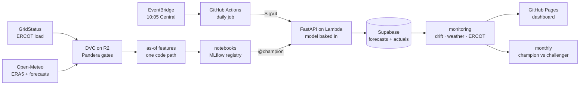

# SHEF 2.0: Short-term Electricity Forecasting

[](https://github.com/oluwadunni1/SHEF2.0/actions/workflows/tests.yml)
[](https://github.com/oluwadunni1/SHEF2.0/actions/workflows/daily.yml)
[](https://oluwadunni1.github.io/SHEF2.0/)
[](LICENSE)

A production forecasting system: every day at **10:00 Central** it forecasts each hour of tomorrow's electricity load for ERCOT's South Central zone (Austin and San Antonio), logs the forecast with its exact inputs, scores itself against published load, and publishes a [live dashboard](https://oluwadunni1.github.io/SHEF2.0/).

It is built around one rule, enforced by tests rather than convention, so the backtest cannot be better than production:

> A feature is allowed only if `source_time + publish_latency <= issue_time`.

## Results

| Holdout Aug 2025 → Oct 2026, scored once | MAPE | Peak-MAPE | RMSE |
|---|---|---|---|
| Baseline: freshest legal same-hour load | 7.62% | 3.79% | 1,013 MW |
| **SHEF: LightGBM on a trend-residual target** | **3.79%** | **3.38%** | **482 MW** |
| ERCOT's own forecast, 120 matched days (Jun–Oct 2026) | 2.79% | 2.52% | 437 MW |

- Scored on **archived weather forecasts**, not observed weather, after selection on three yearly CV folds.
- ERCOT's operator forecast is better overall (ours: 3.65% on the same hours). The gap is under-forecasting while demand set records; in July SHEF was ahead. See [FINDINGS §9](audit/FINDINGS.md).
- Live since 14 Oct 2026; live accuracy next to the backtest is on the [dashboard](https://oluwadunni1.github.io/SHEF2.0/).

## Why a v2

v1 reported **2.84% MAPE**. It was wrong: it trained and scored with yesterday's load for every hour (at 10:00, hours 09–23 are not published yet) and with observed weather instead of a forecast. Neither exists when the forecast is made.

v2 rebuilds the pipeline so every feature is computed as of the issue time, and a test proves it: poison every value after the cutoff and assert no feature changes. Re-inserting v1's mistake makes it fail. The honest number is higher, and it holds up live.

## Architecture



**Stack:** Python 3.14, LightGBM, pandas, Pandera, FastAPI · MLflow (DagsHub) · DVC (Cloudflare R2) · AWS Lambda, ECR, EventBridge Scheduler, SNS, CloudFormation · GitHub Actions (OIDC) · Supabase Postgres · GitHub Pages.

## Engineering highlights

- **Leakage-safe by construction.** Training replays every historical 10:00 issue through the same `build_features` that serving uses. A poisoned-future test (mutation-tested) and a live-vs-replay parity test guard it.
- **Honest validation.** Trained on observed weather, scored on the archived day-ahead forecasts the model would actually have had; the served forecast is archived daily so live inputs match.
- **Gated promotion.** A monthly job retrains a challenger and promotes it only if MAPE improves by ≥ 0.10 points without a worse peak. A rehearsal kept the champion: a month of extra data was worth −0.04 points.
- **Monitoring that was calibrated, not copied.** Textbook PSI thresholds flagged ordinary weather every day; thresholds are calibrated on 1,000+ historical windows, and still catch unit errors and frozen feeds.
- **Fails safe.** If forecast temperature is missing for any hour, the API serves a flagged baseline instead of a silent bad prediction, and the run opens an alert.
- **No long-lived keys, least privilege.** GitHub assumes AWS roles via OIDC; the API URL accepts only signed requests; each component logs into Postgres as its own role, and each role was probed for what it can't do.
- **A real incident, fixed.** GitHub cron silently dropped the first live days while every run was green. The clock moved to EventBridge, and a 13:00 check asks the API whether tomorrow's forecast exists, alerting by email if not. ([FINDINGS §11](audit/FINDINGS.md))

Details: [operations](docs/OPERATIONS.md) · [monitoring and promotion](docs/MONITORING.md) · [every measurement and decision](audit/FINDINGS.md).

## Model card

| | |
|---|---|
| **Model** | `shef2-day-ahead` v1 (`@champion`): LightGBM, default parameters, trend-residual target, 42 point-in-time features. MLflow pyfunc with the forecast gate and feature bundle inside. |
| **Predicts** | Hourly load (MW), ERCOT South Central, all 23–25 hours of the next Central day, issued 10:00 Central (lead 14–38 h). |
| **Data** | GridStatus `ercot_load_by_weather_zone`; ERA5 weather for 4 population-weighted cities; 2016 → Oct 2026, Winter Storm Uri load-shed days excluded. |
| **Inference weather** | Open-Meteo `gfs_seamless` forecast, archived at issue time (DVC). |
| **Selection** | 3 yearly CV folds: 4.18% MAPE. Tuning and ensembling gained ≤ 0.06 points; an LSTM scored 5.46%. |
| **Known weaknesses** | Under-forecasts record demand (Sep 2026 bias −4.3%: trees can't extrapolate). Weekend mornings run +1.3–1.6% high, worst on holiday weekends. Large misses follow wrong weather forecasts. |
| **Intended use** | Portfolio demonstration of a leakage-safe forecasting system, not a dispatch or trading signal. |

## Limitations and next steps

1. **ERCOT is ahead by 0.86 points.** Next: a challenger that tracks the current demand level (recency weighting, ratio target, linear trees), then combining with ERCOT's forecast, which is legal at 10:00.
2. **Point forecasts only.** Next: quantile or conformal prediction intervals.
3. **Short live record.** The backtest is honest but is not a track record; the dashboard accumulates one.
4. **Day-ahead only.** Hour-ahead is a data-cost decision: the free GridStatus plan (250 requests/month) can't support hourly refreshes.

## Running it

```bash
uv sync                    # Python 3.14
uv run pytest              # leakage, parity, data gates, API, monitoring, scheduler: no credentials needed
dvc pull                   # data (private R2 remote)
uv run --env-file .env python scripts/forecast_day.py --dry-run   # forecast tomorrow in-process, log nothing
```

Deploying from scratch: [docs/OPERATIONS.md](docs/OPERATIONS.md#deploying).

<details>
<summary>Repository layout</summary>

```
src/shef/
  sources/      GridStatus + Open-Meteo clients
  features/     as-of views, build_features, bundle, replay, live path
  models/       folds, metrics, targets, GBDT/LSTM, CV, ensemble, tracking, predict.Champion
  serving/      FastAPI app, request schema, Supabase logging, signed client
  monitoring/   weather error, calibrated drift, promotion, ERCOT benchmark, load latency
notebooks/      01 baselines · 02 GBDT · 03 LSTM · 04 ensemble/tuning/SHAP · 05 holdout + registration
scripts/        data, serving, ops and database entry points
infra/          CloudFormation: bootstrap (OIDC, roles, ECR) · api (Lambda) · scheduler (EventBridge, SNS)
sql/            Supabase migrations: tables, views, roles, row-level security
audit/          FINDINGS.md: what was measured, decided and why
```
</details>
