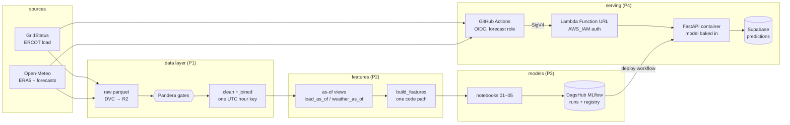

# SHEF 2.0: day-ahead hourly load forecast, ERCOT South Central

Every day at **10:00 Central**, forecast each hour of tomorrow's electricity load for ERCOT's South Central weather zone (Austin and San Antonio), using only data that is actually available at 10:00.

| | MAPE | Peak-MAPE | RMSE |
|---|---|---|---|
| Baseline: freshest legal same-hour load | 7.62% | 3.79% | 1,013 MW |
| **LightGBM + trend target** | **3.79%** | **3.38%** | **482 MW** |

Holdout: Aug 2025 → Oct 2026. It was scored once, on archived weather *forecasts* (not observed weather), after model selection on three yearly CV folds (CV: 4.18% / 2.99%).

## Why v2 exists

v1 reported 2.84% MAPE, but it trained and scored with two inputs a 10:00 forecast cannot have:
- yesterday's load for every hour (at 10:00, hours 09–23 are not published yet);
- observed weather in place of a forecast.

v2 is rebuilt around one rule, enforced by a test rather than by convention:

> A feature is allowed only if `source_time + publish_latency <= issue_time`.

## Architecture



## Design decisions worth reading

- **Point-in-time features.** Training replays every historical 10:00 issue through the same `build_features` that serving uses, fed by `load_as_of` / `weather_as_of`.
  - A **leakage test** poisons every value after the cutoff and asserts no feature moves. It is mutation-tested: planted leaks are caught.
  - A **parity test** asserts that the live path equals replay.
- **One time key.** `ts_utc` is the UTC start of the hour a value describes. Open-Meteo's `time` labels the end of an accumulation hour, so v1 had precipitation one hour early.
- **Honest validation.** Models train on ERA5 history (2016+) but are scored on *archived* day-ahead forecasts (Open-Meteo Previous Runs, `gfs_seamless`). That's the same weather model serving uses.
- **The forecast gate.** A model trained on ERA5 has never seen a missing temperature. In a 2024 archive gap it produced errors of 30–60%.
  - If any target hour lacks forecast temperature, the API serves the baseline instead.
  - It labels that `status: fallback` / `model_name = baseline_same_hour_latest`, and the daily job fails loudly.
- **Serving boundary.** The API validates a full Central day: 23–25 rows, the 10:00 issue time, the weather model, physical bounds, and no unknown fields.
  - It derives the fitted features (trend, holiday frequency, extreme-event flags) itself from the bundle shipped with the model.
  - Every hour is logged with its exact model inputs, issue time, lead time, weather model and MLflow run id.
- **No long-lived cloud keys.**
  - GitHub Actions assumes AWS roles through OIDC. The trust is pinned to the repo's immutable owner/repo ids.
  - Deploying and forecasting use separate roles.
  - The Function URL only accepts SigV4-signed requests.
- **One model version per image.** The deploy workflow pulls a registered version from MLflow and bakes it into the image.
  - It then tests the image under the Lambda runtime emulator before any AWS step.
  - After the deploy, it checks that an unsigned call gets `403` and a signed one reports the expected version.
- **Batch problem, service boundary.** A daily forecast is batch prediction. The API exists to give the model a versioned, validated boundary, and so on-demand or what-if requests need no new code.

## Layout

```
src/shef/
  sources/      GridStatus + Open-Meteo clients
  align.py      UTC hour key for every source
  schemas.py    Pandera gates (raw / clean / joined)
  build.py      clean + join
  features/     as-of views, build_features, bundle, replay, live path, LSTM sequences
  models/       folds, metrics, targets, GBDT/LSTM builders, CV, ensemble, tracking, predict.Champion
  serving/      FastAPI app, request schema, Supabase logging, signed client
notebooks/      01 baselines · 02 GBDT · 03 LSTM · 04 ensemble/tuning/SHAP · 05 holdout + registration
scripts/        backfill, build_clean, build_features, snapshot_forecast, fetch_model, forecast_day, db_migrate
infra/          bootstrap.yaml (OIDC, roles, ECR) · api.yaml (Lambda + Function URL)
sql/            Supabase migrations
audit/FINDINGS.md   what was measured, decided and why
```

## Running it

```bash
uv sync                                    # Python 3.14
uv run pytest                              # leakage, parity, gates, API tests
dvc pull                                   # data (Cloudflare R2 remote)

uv run --env-file .env python scripts/fetch_model.py --version 1        # model -> build/model
uv run --env-file .env python scripts/forecast_day.py --dry-run         # tomorrow, API in-process, nothing logged
```

**Deploying:**
1. Run `infra/bootstrap.yaml` once in CloudShell.
2. Then run the `deploy-api` workflow (input: model version).
3. The `forecast` workflow calls the deployed API.
