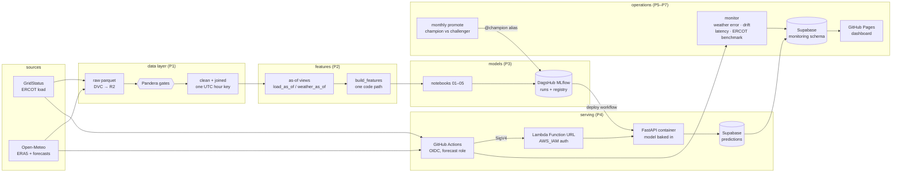

# SHEF 2.0: day-ahead hourly load forecast, ERCOT South Central

[](https://github.com/oluwadunni1/SHEF2.0/actions/workflows/tests.yml)
[](https://github.com/oluwadunni1/SHEF2.0/actions/workflows/daily.yml)
[](https://oluwadunni1.github.io/SHEF2.0/)

Every day at **10:00 Central**, forecast each hour of tomorrow's electricity load for ERCOT's South Central weather zone (Austin and San Antonio), using only data that is actually available at 10:00.

| | MAPE | Peak-MAPE | RMSE |
|---|---|---|---|
| Baseline: freshest legal same-hour load | 7.62% | 3.79% | 1,013 MW |
| **LightGBM + trend target** | **3.79%** | **3.38%** | **482 MW** |

**Against ERCOT's own published forecast** (the 09:30 CT publish, the same information cut-off), on 120 matched summer days of 2026:
- ERCOT is better overall: **2.79% vs 3.65%** MAPE.
- The gap is systematic under-forecasting while demand set records (our September bias −4.3%).
- In July we beat ERCOT (2.85% vs 3.06%).
- Details: [FINDINGS section 9](audit/FINDINGS.md).

Holdout: Aug 2025 → Oct 2026. It was scored once, on archived weather *forecasts* (not observed weather), after model selection on three yearly CV folds (CV: 4.18% / 2.99%).

## Why v2 exists

v1 reported 2.84% MAPE, but it trained and scored with two inputs a 10:00 forecast cannot have:
- yesterday's load for every hour (at 10:00, hours 09–23 are not published yet);
- observed weather in place of a forecast.

v2 is rebuilt around one rule, enforced by a test rather than by convention:

> A feature is allowed only if `source_time + publish_latency <= issue_time`.

## Architecture



Everything runs on schedules in GitHub Actions: `daily` (10:00 Central), `promote` (monthly), `deploy-api` (on serving changes or a promotion), `tests` (every push).

## Design decisions worth reading

- **Point-in-time features.** Training replays every historical 10:00 issue through the same `build_features` that serving uses, fed by `load_as_of` / `weather_as_of`.
  - A **leakage test** poisons every value after the cutoff and asserts no feature moves. It is mutation-tested: planted leaks are caught.
  - A **parity test** asserts that the live path equals replay.
- **One time key.** `ts_utc` is the UTC start of the hour a value describes. Open-Meteo's `time` labels the end of an accumulation hour, so v1 had precipitation one hour early.
- **Honest validation.** Models train on ERA5 history (2016+) but are scored on *archived* day-ahead forecasts (Open-Meteo Previous Runs, `gfs_seamless`). That's the same weather model serving uses.
- **The forecast gate.** A model trained on ERA5 has never seen a missing temperature. In a 2024 archive gap it produced errors of 30–60%.
  - If any target hour lacks forecast temperature, the API serves the baseline instead.
  - It labels that `status: fallback` / `model_name = baseline_same_hour_latest`, and the daily job fails loudly.
- **Serving boundary.** The API validates a full Central day: 23–25 rows, the 10:00 issue time, the weather model, physical bounds, and no unknown fields.
  - It derives the fitted features (trend, holiday frequency, extreme-event flags) itself from the bundle shipped with the model.
  - Every hour is logged with its exact model inputs, issue time, lead time, weather model and MLflow run id.
- **No long-lived cloud keys.**
  - GitHub Actions assumes AWS roles through OIDC. The trust is pinned to the repo's immutable owner/repo ids.
  - Deploying and forecasting use separate roles.
  - The Function URL only accepts SigV4-signed requests.
- **Least privilege in the database too.** Each component logs in as its own Postgres role, and every role was probed for what it can and cannot do:

  | role | used by | can | cannot |
  |---|---|---|---|
  | `api_writer` | Lambda | insert forecasts, fill `actual_load_mw` | read features, delete, change a forecast, see or touch backtest rows (RLS) |
  | `monitor_writer` | daily monitoring | write the monitoring tables, read the monitoring views | read or write `predictions` |
  | `dashboard_reader` | Pages build | read the monitoring views | write anything, read `predictions` directly |

  The `postgres` login is only used for migrations (`scripts/db_migrate.py`), from a laptop.
- **One model version per image.** The deploy workflow pulls a registered version from MLflow and bakes it into the image.
  - It then tests the image under the Lambda runtime emulator before any AWS step.
  - After the deploy, it checks that an unsigned call gets `403` and a signed one reports the expected version.
- **Batch problem, service boundary.** A daily forecast is batch prediction. The API exists to give the model a versioned, validated boundary, and so on-demand or what-if requests need no new code.

## Monitoring and promotion

**Live dashboard: https://oluwadunni1.github.io/SHEF2.0/** It's rebuilt after every daily run from a read-only database role.

- **Accuracy.** Live 30-day MAPE, Peak-MAPE, RMSE and bias next to the holdout backtest. The backtest rows sit in the same table under `backtest-1`, and the SQL views reproduce P3's 3.79% / 3.38% / 482 MW exactly.
- **Served weather.** Each archived `gfs_seamless` snapshot is scored once ERA5 is final:
  - against what was observed;
  - against the archived forecast the model was trained on. This checks that the training proxy matches what serving actually sees.
- **Input drift.** PSI on the hourly inputs against the same calendar month in the last 3 training years.
  - Textbook PSI thresholds flag ordinary weather every day here. So the thresholds are **calibrated** on 1,000+ historical 14-day windows: watch above the 95th percentile, drift above the 99th.
  - Daily-level features are excluded because their PSI saturates.
  - It catches unit errors and frozen feeds (PSI ≈ 8.3). It also flagged real early-October 2026 load growth.
- **Promotion (monthly).**
  - The data is refreshed through the DVC pipeline.
  - The champion's recipe is retrained on newer data, and both models are scored on the latest 28 labelled days neither has seen (rolling origin).
  - The challenger is promoted only if MAPE improves by ≥ 0.10 points without a worse Peak-MAPE.
  - A promotion registers vN, moves the MLflow `@champion` alias and redeploys.
  - A rehearsal on Sep 2026 kept the champion: 4 more weeks of training data gave −0.04 points of MAPE and a worse peak. The margin is there to prevent that kind of churn.

- **Operations.**
  - **Publishing latency** is measured for free. Every daily load fetch records the newest hour GridStatus returned, which brackets how late the next hour is. This tests the 1-hour cutoff the features assume, instead of trusting one P0 sample.
  - **Failures open a GitHub issue** (`ops-alert`): a failed or fallback forecast, a failed dashboard build, or a monitoring step that failed quietly under `continue-on-error`. One issue per day; later slots comment on it.

## Model card

| | |
|---|---|
| **Model** | `shef2-day-ahead` v1 (`@champion`), LightGBM (default parameters) on a trend-residual target, 42 point-in-time features. MLflow pyfunc: forecast gate, feature bundle and trend line ship inside it. |
| **Predicts** | Hourly load (MW), ERCOT South Central weather zone, all 23–25 hours of the next Central day, issued at 10:00 Central (lead 14–38 h). |
| **Training data** | GridStatus `ercot_load_by_weather_zone` and ERA5 weather (4 cities, population-weighted), 2016-01-12 → 2026-10-09. Winter Storm Uri load-shed days excluded. |
| **Weather at inference** | Open-Meteo `gfs_seamless` day-ahead forecast, archived at issue time (DVC). Trained on observed weather, validated on archived forecasts. |
| **Evaluation** | Holdout Aug 2025 → Oct 2026, scored once: **3.79% MAPE**, 3.38% Peak-MAPE, 482 MW RMSE (5.1% of mean load), −0.17% bias. Seasonal baseline 7.62%. ERCOT's own forecast on 120 matched days: 2.79% vs our 3.65%. |
| **Intended use** | A portfolio demonstration of a leakage-safe forecasting system. Not an operational dispatch or trading signal. |
| **Known failure modes** | Under-forecasts during record-breaking demand (Sep 2026 bias −4.3%): tree models cannot extrapolate beyond the training range, and the trend term adapts slowly. Largest misses come from wrong weather forecasts (convective rain, frontal timing), which the model cannot see. No prediction if forecast temperature is missing: the baseline is served instead and flagged. |
| **Not modelled** | Prediction intervals, price response, outages and load shed, rooftop solar growth beyond the trend. |

## Limitations and what I'd do next

Stated plainly, because an interviewer will find them anyway:

1. **ERCOT's operational forecast is better** by 0.86 MAPE points on the 120 days compared (we win 39% of hours; July is ours). The gap is level adaptation: during record demand we under-forecast. Next: a recency-weighted or ratio-target challenger, put through the existing promotion gate with ERCOT as a second bar.
2. **Point forecasts only.** No intervals, so no "how sure?" answer. Next: quantile LightGBM or conformal intervals, checked for coverage on the holdout.
3. **Short live record.** The system went live on 2026-10-13. Backtest numbers are honest (archived forecasts, scored once), but they are not a track record; the dashboard shows the live numbers next to them as they accrue.
4. **Scheduler risk.** GitHub cron is best-effort and dropped a whole day before go-live. Three slots and a catch-up cover delays; a day with no run at all is visible on the dashboard but does not open an issue.
5. **Hour-ahead is out of scope.** Data cost, not modelling: the GridStatus free plan (250 requests a month) cannot support hourly refreshes ([FINDINGS section 8](audit/FINDINGS.md)).
6. **Reproducibility needs credentials.** Data lives in a private DVC remote and runs in a private MLflow. The test suite (leakage, parity, gates, API, monitoring) needs neither and runs on every push.

## Layout

```
src/shef/
  sources/      GridStatus + Open-Meteo clients
  align.py      UTC hour key for every source
  schemas.py    Pandera gates (raw / clean / joined)
  build.py      clean + join
  features/     as-of views, build_features, bundle, replay, live path, LSTM sequences
  models/       folds, metrics, targets, GBDT/LSTM builders, CV, ensemble, tracking, predict.Champion
  serving/      FastAPI app, request schema, Supabase logging, signed client
  monitoring/   served-weather error, calibrated drift, champion/challenger, ERCOT benchmark, load latency
notebooks/      01 baselines · 02 GBDT · 03 LSTM · 04 ensemble/tuning/SHAP · 05 holdout + registration
scripts/        data: backfill, build_clean, build_features, snapshot_forecast
                serving: fetch_model, forecast_day · ops: monitor, render_dashboard, promote, ercot_benchmark
                database: db_migrate, set_role_login, load_backtest
infra/          bootstrap.yaml (OIDC, roles, ECR) · api.yaml (Lambda + Function URL)
sql/            Supabase migrations
audit/FINDINGS.md   what was measured, decided and why
```

## Running it

```bash
uv sync                                    # Python 3.14
uv run pytest                              # leakage, parity, gates, API tests
dvc pull                                   # data (Cloudflare R2 remote)

uv run --env-file .env python scripts/fetch_model.py                    # @champion -> build/model
uv run --env-file .env python scripts/forecast_day.py --dry-run         # tomorrow, API in-process, nothing logged
```

**Deploying:**
1. Run `infra/bootstrap.yaml` once in CloudShell.
2. Apply `sql/` with `scripts/db_migrate.py`, and create the three role logins with `scripts/set_role_login.py` (it stores each as a GitHub secret).
3. Run the `deploy-api` workflow (input: a model version, or `champion`).
4. The `daily` workflow runs at 10:00 Central:
   - it snapshots the weather forecast to DVC;
   - it forecasts tomorrow through the API from that same snapshot;
   - it backfills actual load.

   A fallback or a missing forecast fails the run and opens an `ops-alert` issue.
